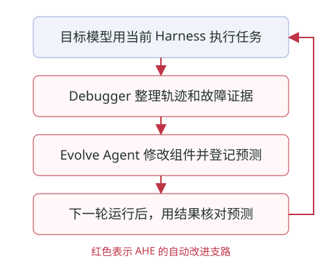

<strong>问题与方法</strong>　Harness 的故障难定位，修改效果也难归因。AHE 将组件、执行证据和修改预测分别记录下来，让外部 Agent 据此修改运行框架，再用下一轮的任务结果核对。

<!-- more -->

## 第 3 节的三个设计

*根据论文 §3 整理的结构示意图。*

| 设计 | 回答的问题 | 实际做法 |
| --- | --- | --- |
| 组件可观察性 | 哪里能改？ | NexAU 将系统提示、工具描述、工具实现、中间件、技能、子 Agent 配置和长期记忆分别放在可编辑的文件里。修改有版本记录，可以按文件回退。 |
| 经验可观察性 | 凭什么改？ | Agent Debugger 分析同一任务的多条执行轨迹，形成逐任务报告和基准总览。原始轨迹仍可查阅，用于核对报告里的判断。 |
| 决策可观察性 | 改了以后怎么验？ | Evolve Agent 修改 harness，并在变更清单里登记失败证据、推测的根因、改法、预计改善的任务和可能退步的任务。下一轮再逐项核对。 |

目标模型的权重保持固定。修改由外部 Evolve Agent 提出并实施，写入范围限于 harness 工作区。运行记录、验证器和模型配置保持只读。[论文 §3](https://arxiv.org/html/2604.25850v4#S3)

## 一项修改怎样变成可检验的预测？

教学例子

如果执行记录显示 Agent 常在产出文件前就结束，可以在中间件里加一个结束检查。改动时先写下预测：要求生成文件的任务应该改善，只要求文字答复的任务则可能被误拦。下一轮运行后，就能核对哪些预期改善发生了，哪些回归没有被预料到。

**总分和逐任务结果回答不同的问题。** 总分显示这一轮整体表现的变化，逐任务结果能检查变化是否符合预测。如果同一轮合入多项修改，可以再做单独对照，确认某一项改动贡献了多少。[论文 §3.3](https://arxiv.org/html/2604.25850v4#S3.SS3)

## 两个评测基准

| 基准 | 测什么 | 在 AHE 中怎么用 |
| --- | --- | --- |
| Terminal-Bench 2.0 | 在终端环境中完成配置软件、处理数据或生成产物等多步骤技术任务，由测试验证结果。 | 使用全部 **89 道题**产生轨迹，驱动 harness 迭代并核对预测。 |
| SWE-bench Verified | 根据真实 GitHub issue 修复代码仓库，提交补丁并用测试验证。 | 在 **500 道题**上测试迁移，直接使用在 Terminal-Bench 上演化好的 harness。 |

在 SWE-bench Verified 上，相比初始 NexAU harness，成功率从 **75.2% 提高到 75.6%**，平均每次尝试的 token 从 **526k 降到 461k**。这组结果里，成本下降约 **12%**，成功率增加 **0.4 个百分点**。[论文 §4.1–4.3](https://arxiv.org/html/2604.25850v4#S4)

<aside class="paper-question">
一个研究问题：分层整理证据划算吗？

如果把 Debugger 整理报告的成本也算上，在相同的总预算下，先看报告、再按需回查原始轨迹，能否比直接查原始轨迹产生更多有效的 harness 修改？
</aside>
