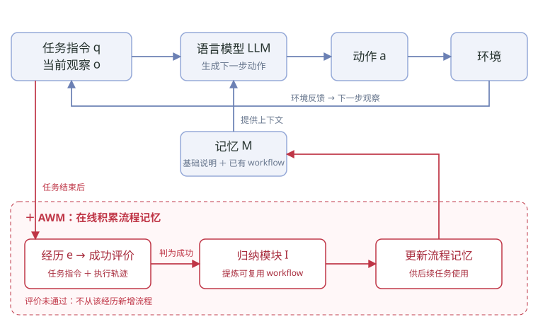

<strong>问题：</strong>Agent 往往逐个任务从头摸索；<strong>方法：</strong>AWM 从执行经历中归纳可复用的子任务流程，加入记忆，辅助后续行动。

<!-- more -->

## 先看结构：AWM 新增了哪一环？

通用 Agent 根据任务、当前观察和记忆生成动作，再从环境获得反馈。**AWM 增加的是任务结束后的经验积累支路**：把被判成功的经历归纳成 workflow，更新后续任务的记忆。

*结构示意，非论文原图。红色展示在线 AWM；离线 AWM 预先从已有样例归纳流程，再使用固定记忆。模型权重与基础执行机制保持不变。*

## 01　从具体经历到可复用的 workflow

AWM 关注的问题是：Agent 做过一件事之后，能否从中提炼出通用流程，帮助后续任务少一些重复摸索？理解方法之前，需要先区分两个概念。

<strong>Experience · 经历</strong>

一次具体任务的指令，以及尝试完成任务时产生的执行轨迹。轨迹记录每一步的观察和动作。

<strong>Workflow · 工作流程</strong>

从经历中提炼出的可复用子任务，包含功能描述，以及相应的操作步骤。

归纳模块 **I** 接收一条或多条经历，通过提示语言模型提取通用子任务。关键有两步：**缩小到可复用的子任务，以及将具体值替换成通用参数。**

简化示例，非论文实验轨迹

具体经历：搜索干猫粮，并完成后续购物操作 ↓ 归纳模块 I <strong>可复用子任务：搜索 {product-name}</strong> ↓ 加入流程记忆，供后续任务参考

使用时，模型同时看到当前任务、包含 workflow 的记忆和当前观察，再生成下一步动作。流程提供参考，并不意味着忽略当前页面、直接回放整段操作。

这里更新的是什么？

模型负责归纳流程，外部程序负责将其写入记忆。<strong>AWM 更新的是上下文中的经验，没有修改 harness 的运行代码。</strong>

## 02　离线与在线：记忆什么时候更新？

| | 离线 AWM | 在线 AWM |
| --- | --- | --- |
| 经历来源 | 已有的人工标注或模型生成样例 | Agent 执行任务产生的经历 |
| 归纳时机 | 测试之前集中提炼 | 每个任务结束后，从被评价模型判为成功的经历中提炼 |
| 记忆变化 | 测试期间使用同一份流程记忆 | 新流程加入记忆，供后续任务使用 |

离线方式像是先编好操作手册，再开始做题；在线方式则是在执行任务的过程中，逐步积累手册。在线新增的流程用于后续任务，并非自动让当前失败任务重做一次。

<aside class="paper-question">

我的疑问：什么时候停止？

<strong>单个任务：</strong>模型输出 STOP，或者达到最大步数等预设终止条件。<strong>停止不等于成功</strong>；在线设置还会调用评价模型，判断这次经历是否值得用于归纳。

<strong>流程积累：</strong>论文在线实验在所有给定测试任务处理完后结束，<strong>没有设计“已经学够了”的自主停止条件。</strong>

</aside>

## 03　两个测评基准：执行与预测

### WebArena：在可交互网站里完成任务

它提供购物、论坛、协作开发、内容管理等功能完整的测试网站，也包括地图工具。重点是环境可以受控地部署、重置，便于重复实验。

简化示例

让 Agent 在指定论坛版块发布一篇帖子。它需要自己进入版块、填写内容并提交；评测检查帖子是否真正发布成功。

自己的操作会改变后续环境，因此 Agent 需要应对整条执行链路中的错误，而不仅是判断某一次点击。

### Mind2Web：根据网页状态预测操作

原版 Mind2Web 收集了来自 **137 个网站、31 个领域的两千多个任务**，包含人工演示的操作序列和网页状态。

简化示例

给定航班查询任务和记录好的页面状态，让模型预测应选中“出发城市”输入框，并输入“上海”。评测比较它选择的元素和操作是否与标注一致。

原版采用逐步离线评测，不等于让 Agent 在实时网站上自由操作，直到完成整个任务。

<strong>WebArena 主要检查任务最终有没有办成；原版 Mind2Web 主要检查给定网页状态下，每一步操作预测得对不对。</strong>

[AWM 原文 §2.3、§3](https://arxiv.org/html/2409.07429v1) · [WebArena](https://arxiv.org/abs/2307.13854) · [Mind2Web](https://arxiv.org/abs/2306.06070)
