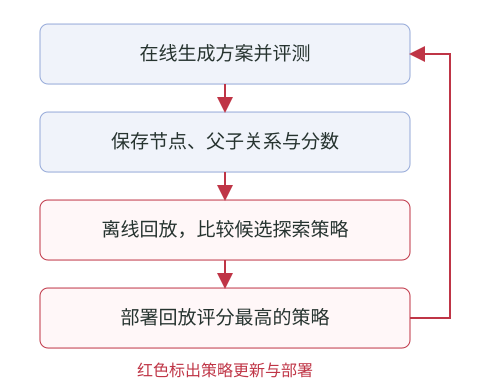

<strong>问题与方法</strong>　每试一种新的探索策略都重新生成和评测方案，成本很高。Dream-RSI 把历次真实搜索记录成发现树，先在树上回放比较策略，再让表现最好的策略指导下一轮真实搜索。

<!-- more -->

## Dream-RSI 改的是哪一层？

搜索一个更好的程序时，负责生成代码的 Agent 每次从一个已有方案出发，提出修改并交给评估器打分。还需要一个外层策略决定<strong>从哪个方案继续、哪些尝试一起做、何时停止</strong>。Dream-RSI 更新的是这层策略代码，底层发现 Agent 保持固定。

根据论文第 3 节整理。红色标出以历史发现树为输入的策略更新。

## 发现树怎样变成回放环境？

**在线搜索。** 每次调用底层发现 Agent，系统都记录生成的候选、评测结果及其父节点。积累下来的发现树描述了一轮真实搜索实际走过的路径。

**离线回放。** 换一套策略在同一棵树上做决策。策略只能根据已经揭晓的节点选择下一步。选中某个节点后，回放器按记录顺序揭晓该节点尚未看到的后续结果。

教学例子

假设历史上，80 分的 A 下一步得到 81 分，70 分的 B 下一步却得到 90 分。回放刚开始时，策略只能看到 A 和 B。它要先决定继续探索 B，才会看到 90 分。在线搜索若再选一次 B，底层 Agent 则会真的生成一个新方案，结果由新的评测决定。

### 怎样选出下一轮的策略？

1. **在不同预算偏好下回放。** 记录每套策略用多少次发现 Agent 调用，找到多高的分数。评分奖励用较少调用找到较好结果，也偏好能将调用集中到较少顺序轮次的并行策略。
2. **让策略开发 Agent 修改策略代码。** 它查看回放轨迹、得分和此前的修改反馈，提出下一版策略。
3. **在同一批历史树上比较。** 系统把当前策略也留在候选中，选平均回放分最高的版本部署到下一轮。新的在线搜索又会生成一棵发现树，供后续回放。

离线评分和在线效果

候选策略能在已有历史上至少追平当前策略，因为当前策略也参与比较。回放只能揭晓过去实际探索过的分支。策略走到真实环境后能否更快找到好方案，还得看在线搜索的结果。

## 四组任务怎么测？

| 方向 | 任务 | 如何评分 |
| --- | --- | --- |
| GPU kernel 优化（4 项） | KernelBench 的 VGG16、LayerNorm、ConvDiv、ConvMax | 验证计算正确性后，比运行速度 |
| 数学优化（3 项） | 和差问题、自相关不等式、圆堆积 | 用每道题各自的目标函数给数学构造打分 |
| 算法工程（1 项） | Lasso 正则化路径求解 | 用 17 个合成实例搜索，再看求解器在 6 个留出数据集上的运行时间和数值正确性 |
| Harness 优化（1 项） | 以 Terminus-Kira 为起点搜索 harness | 每个候选跑全量 Terminal-Bench 2.1 的 89 道任务，每题独立运行两次，按任务成功率评分 |

**前三组把策略更新和固定策略作对照。** 两边采用同一个发现 Agent、评估器和初始策略。第二轮起，Dream-RSI 用回放更新策略，对照组沿用初始策略。论文以累计发现 Agent 调用次数衡量搜索成本。例如，Lasso 的 Gemini-3.1 Pro 实验用了 **317 次调用**，固定策略组用了 **550 次**。最终求解器在留出集上的平均运行时间更短，收益主要来自其中一个数据集。[论文 §4](https://arxiv.org/html/2609.14858#S4)

**Harness 实验测的是整套搜索的表现。** Terminal-Bench 2.1 上，初始 harness 的成功率为 **72.47%**，Dream-RSI 找到的版本为 **80.90%**，论文复现的 Meta-Harness 为 **79%**。这一组因成本省略了固定策略对照，因此回放更新单独带来了多少收益仍是开放问题。[论文 §4.4](https://arxiv.org/html/2609.14858#S4.SS4)

<aside class="paper-question">

历史上没有走到的分支怎么办？

高回放分说明策略善于利用历史中有记录的机会。如果旧策略总是优先探索高分分支，回放也可能缺少低分分支的后续结果。一个可以比较的问题是，多保留几棵由不同探索策略生成的树，能否让离线筛出的策略在真实搜索里也更有效？

</aside>

[Dream-RSI 原文](https://arxiv.org/html/2609.14858)
