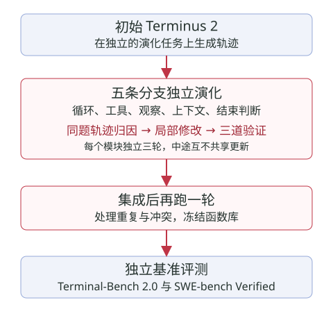

**arXiv 首发** [2026-09-14](https://arxiv.org/abs/2609.14857) · **发表场合** arXiv 预印本，暂未核实到会议或期刊发表 · **阅读版本** [arXiv v2（2026-10-09）](https://arxiv.org/html/2609.14857v2)

为了让 Agent 找到可迁移的 Harness 改动，ModularRSI 对比同题的成功与失败轨迹，把改动限制在对应模块，并用独立基准检验整合后的效果。

<!-- more -->

## 一道题失败，具体该改哪里

待演化的 Agent 也承担代码修改者的角色。它先比较同一道题的成功和失败轨迹，找出行为从哪一步开始分岔，再判断这个差异能否由当前开放的模块处理。若当前几次尝试都失败，就优先找同题的历史成功轨迹。有些问题只能从失败记录诊断。若任务每次都通过，作者也会找多余的操作和重试。诊断需要跨任务积累证据，同一函数的相似建议合并后，每个支持它的不同任务计一票，每批优先处理前 10 项。[论文 §3.1、§3.3–3.4](https://arxiv.org/html/2609.14857v2#S3.SS3)

*根据论文 §3–4 整理的流程示意。红色标出归因、分模块更新与整合。*

### 五个模块各管什么

| 模块 | 可改的机制 |
| --- | --- |
| Agent Loop | 控制执行循环、推进步骤和失败恢复 |
| Tool Use | 解析、分派与执行工具调用 |
| Observation Management | 整理当前一轮的环境反馈，过滤噪声 |
| Context Management | 保存、压缩和恢复跨轮对话历史 |
| Task Completion Detection | 根据运行状态建议继续或结束，由 Agent Loop 执行决定 |

五条分支从同一份 Terminus 2 出发，各自演化三轮，中途互不共享更新。修改依次通过**程序检查、差异审查、执行验证**。差异审查关注写死题目细节的改动，执行验证随机抽取当前批次两道题检查运行错误和协议问题。任一环节失败，系统都回退该修改。[论文 §3.2–3.5、§5.3](https://arxiv.org/html/2609.14857v2#S3.SS2)

### 两个实际改动

- **Agent Loop 保留任务清单。** 同一道题的成功轨迹遵守了明确的数据过滤要求，失败轨迹为了贴合旧实现而丢掉这项要求。新版本在后续提示里继续展示任务清单，并在 Agent 直接宣布完成时提示核对。相同任务后来从三次运行中一次通过变成两次通过，这组轨迹展示了行为如何变化。[附录 K.2](https://arxiv.org/html/2609.14857v2#A11.SS2)
- **Tool Use 改进多行内容的分派。** 写文件工具收到多行文本时，旧分派器错误地把调用交给 shell，引发重试。新版本按工具名分派并保留多行参数。论文案例中三次运行仍全部通过，平均交互轮数从 **36 降到 25**。[附录 K.4](https://arxiv.org/html/2609.14857v2#A11.SS4)

### 合并后为什么再跑一轮

两个模块各自有效，放到一起仍可能重复处理同一段信息，或对同一个结束信号做出冲突判断。作者把五条分支合并后，在**演化任务上额外跑一轮**，根据轨迹去除重复机制、调整分工。演化时也会合并模块内功能重叠的函数。整合后函数库冻结，下游评测时仍可以按任务选择要启用的函数。[论文 §3.6–3.7](https://arxiv.org/html/2609.14857v2#S3.SS6) · [官方模块代码](https://github.com/IQuestLab/ModularRSI/tree/main/generations/merged_active)

## 演化用的题从哪来

作者参考 Terminal-Bench 和 SWE-bench 的**任务大类**，从 GitHub、Kaggle、Hugging Face 等外部来源构造 **2,000 道**可执行任务。每道题过环境和测试检查，参考解答须能通过测试，空操作须拿不到正奖励。人工复核后再用 LLM 做语义相似度筛查，剔除和下游基准重合度高的任务。主实验实际从终端类和仓库修复类任务池**各抽 120 道**分别做演化。[论文 §4、§5.3](https://arxiv.org/html/2609.14857v2#S4)

<aside class="paper-question">

相似任务筛查能复现到哪一步？

正文交代了筛选顺序，原文未报告筛查模型、提示词、候选配对方法或淘汰阈值。因此可以复述筛查流程，无法仅凭论文复刻同一套淘汰结果。若用这批题做后续研究，这些是评估任务重合时需要进一步核对的细节。

</aside>

## 评测支持了什么

主实验用 **DeepSeek-V4-Flash-Preview**，初始框架是未演化的 Terminus 2。Terminal-Bench 2.0 的 **89 道题**和 SWE-bench Verified 的 **500 道题**都用于下游评估。表中的 Acc 是全部评测轨迹的平均成功率。论文还用 Pass@3 统计三次尝试中至少通过一次的题目比例，用 Pass³ 统计三次都通过的比例。以终端类任务演化后的 Terminal-Bench 2.0 结果为例，两项分别从 **58.43% 到 65.17%**、从 **30.34% 到 35.96%**。[论文 §5–6.1](https://arxiv.org/html/2609.14857v2#S5)

| Harness 演化来源 | Terminal-Bench 2.0 Acc | SWE-bench Verified Acc |
| --- | ---: | ---: |
| 未演化 | 47.57% | 73.40% |
| 终端类任务 | **52.43%** | 75.80% |
| 仓库修复类任务 | 49.44% | **76.40%** |

同领域演化的收益更大，换到另一类基准后仍有提升。冻结终端类任务演化出的 Harness 再换模型，Terminal-Bench 2.0 上的 GLM-5.2 从 **59.55% 到 61.80%**，MiniMax-2.5 从 **41.57% 到 44.94%**。这些数字描述的是论文实际测试的迁移范围。[论文 §6.1–6.2，表 1–2](https://arxiv.org/html/2609.14857v2#S6.SS1)

在 Terminal-Bench 2.0 上，作者按每题三条轨迹和 **16 轮总演化量**对齐预算。联合演化所有模块得到 **44.19%**，非模块化整套演化得到 **46.44%**，ModularRSI 达到 **52.43%**。去掉成功与失败轨迹的对比后降到 **50.56%**。单模块对照里，Observation Management 把平均交互步数从 **34.70 降到 22.50**，整合版的步数则是 **35.57**，对应更高的平均成功率。不同改动带来的收益可以是更高的通过率，也可以是较少的交互，需要分别看指标。[论文 §6.3–6.4，表 3–5](https://arxiv.org/html/2609.14857v2#S6.SS3)
