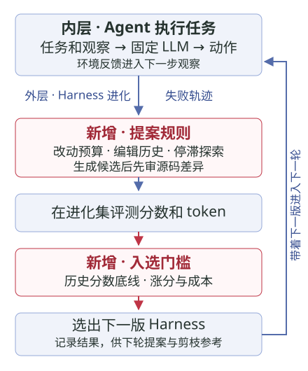

**arXiv 首发** [2026-09-21](https://arxiv.org/abs/2609.24972) · **发表场合** arXiv 预印本，暂未核实到会议或期刊发表 · **阅读版本** [arXiv v3（2026-10-04）](https://arxiv.org/html/2609.24972v3)

反复在同一批任务上改 Harness 容易把分数刷高却失去迁移性，RRSI 给外层的提案和筛选加上正则化，让更有证据、成本合理的改动进入下一版。

<!-- more -->

第一作者记录了该研究在 2026 年 10 月的 Google COLM 2026 Expo 展示。 [作者主页](https://richard-peng-xia.github.io/index.html) · [Google 活动日程](https://research.google/conferences-and-events/google-at-colm-2026/)

## 正则化加在 Agent 的哪一层？

Agent 做题时，模型根据任务和环境观察决定下一步动作，Harness 负责提示词、工具、上下文和执行流程。RRSI 在外层用另一个 LLM 提案角色**修改 Harness 的源码**。底座模型权重固定，提示词、控制流、工具、记忆、技能和子 Agent 等组件都可以改。每一轮用同一批进化任务收集反馈、测试改动、决定下一版，因此同一份评测反馈会反复影响搜索方向。 [论文 §2–3.1](https://arxiv.org/html/2609.24972v3#S2)

<figure class="paper-diagram" style="max-width: 32rem; margin-inline: auto;">

<figcaption class="paper-caption">根据论文图 2 与附录 D 整理。红色标出 RRSI 加在外层进化中的规则。</figcaption>
</figure>

## 一轮进化怎么走？

<section class="paper-card">

<strong>提案端控制怎么试</strong>

限制一个候选能打包几项改动，用历史记录指导提案，停滞时给没试过的组件留名额。

</section>
<section class="paper-card">

<strong>筛选端控制留什么</strong>

先审源码差异，再实测分数和 token 成本。通过门槛后才能竞争下一版，删除组件也要走同一套流程。

</section>

### 提案端少改几项，才知道哪一项有用

1. **限制单个候选的改动数（L₀ 式约束）。** 预算按余弦曲线收紧，实验设定的起始上限是 3 或 4 项，下限是 1 项。前期可以组合几项相互配合的改动，后期更容易把分数变化归因到某一项。例如同时加提交前检查和工具重试，涨分后还得拆开才能判断谁起了作用。
2. **保存每次尝试的证据。** 记录改了哪个组件、验证的假设、源码差异、分数与 token 的变化，以及候选是否入选。后续提案能参考失败记录。一个候选打包的几项改动共享同一次测量结果，账本里的记录也会有这个归因限制。
3. **停滞时换个地方试。** 最近几轮的得分进步如果落在评测噪声范围内，系统会预留一部分提案名额，分给此前未实际评测过的组件。 [论文 §3.2、附录 D.2](https://arxiv.org/html/2609.24972v3#S3.SS2)

### 筛选端用两个分数参照

1. **评测前审差异。** Critic 检查实际写进 Harness 的改动，拒绝把题目、答案、特定数值或只服务于进化基准的逻辑写进源码的候选，也会挡掉加进去却不起作用的机制。提案理由可以用具体任务解释自己想解决什么。
2. **和历史最好分比，守住性能底线。** 进化前重复评测初始 Harness，估计实测分的自然波动 δ。候选至少要达到「初始和历轮入选版本的最高分 − δ」。这个底线只会随历史纪录上升，可以防止几次小退步累积成一次大退步。
3. **和当前版本比，判断涨分值不值额外 token（L₂ 式控制）。** 涨分超过 δ 时，涨得越多，允许多花的 token 就越多。涨分未超过 δ 时，筛选会综合小幅分差、token 成本和结构新颖度。在编码实验中，这一档的小幅分差权重为零，候选须靠省 token 或引入此前从未入选的结构类型争取通过。系统在所有通过门槛的候选里选实测分数最高的，若无人通过，就保留当前版本。
4. **给删除留一个入口（L₁ 式剪枝）。** 如果某个试过的组件在近期没有观察到正向收益，系统会把它标为后续可清理的目标。提案者可以提出删除，删除方案仍需评测和筛选。 [论文 §3.3](https://arxiv.org/html/2609.24972v3#S3.SS3) · [附录 D](https://arxiv.org/html/2609.24972v3#A4)

L₀、L₁、L₂ 在这里是类比，分别对应**限制每次改动数量、删除缺乏收益的组件、控制总体推理开销**。论文把这些原则落实为对离散代码改动的规则。 [论文 §3.1](https://arxiv.org/html/2609.24972v3#S3.SS1)

### 两个被拒绝的真实候选

- 编码第 0 轮，有个候选加了验证提醒并调整长任务处理方式。它**涨了 1.69 个百分点，token 多了 26.1%**。涨幅落在约 1.7 个百分点的噪声范围内，成本规则把它挡了下来。
- 编码第 8 轮，有个候选在提交前重新展示原始任务指令。它**省了 13.6% 的 token，但掉了 2.81 个百分点**，跌破历史分数底线。 [附录 F，表 8](https://arxiv.org/html/2609.24972v3#A6)

## 换到没见过的任务还有效吗？

论文在编码、办公和工程设计三个领域**分别进化一套 Harness**。主实验固定 Claude Opus 4.8，最终版本直接拿去跑留出数据。下表是相对各自初始 Harness 的分数变化。Harvey LAB 的 40 道留出题和进化任务同分布，其余五个留出基准用来测跨分布迁移。 [论文 §4.1–4.2](https://arxiv.org/html/2609.24972v3#S4) · [附录 E，表 6–7](https://arxiv.org/html/2609.24972v3#A5.SS2)

| 领域 | 进化时看得见的任务 | 进化时看不见的任务 |
| --- | --- | --- |
| 编码 | Terminal-Bench 2.1，89 道容器化终端任务 **+6.0** | SWE-bench Verified，真实仓库修复 **+1.8** |
| 办公 | Harvey LAB，120 道法律工作任务 **+1.1** | Harvey LAB 留出 **+2.3**，JobBench **+4.7**，GDPval **+3.5**，APEX-Agents **+3.7** |
| 工程设计 | EngDesign，61 道设计题 **+4.9** | Frontier-Eng，按仿真或测试结果评分 **+4.3** |

办公任务的消融实验里，各版本从同一初始 Harness 出发，使用相同进化集和候选预算。分布外均分由 JobBench、GDPval 和 APEX-Agents 三项组成。token 开销在 Harvey LAB 进化集上测量。 [论文 §4.3，表 2 与图 4](https://arxiv.org/html/2609.24972v3#S4.SS3)

| 进化方式 | 进化集分数 | 分布外均分 | 每次 token（百万） |
| --- | ---: | ---: | ---: |
| 初始 Harness | 89.4 | 39.7 | 1.56 |
| 无正则化 | **92.8** | 40.3 | 3.80 |
| 去掉提案规则 | 90.7 | 41.9 | 2.69 |
| 去掉筛选规则 | 91.5 | 41.0 | 3.59 |
| 完整 RRSI | 90.5 | **43.6** | 2.42 |

**只按进化集选版本，会选中 92.8 分的无正则化版本，它到了新基准平均少拿 3.3 分。** 完整 RRSI 的 token 开销比无正则化版本少约 36%，比初始 Harness 仍多。这组实验把迁移收益和推理成本放到了同一张表里。 [论文 §4.3](https://arxiv.org/html/2609.24972v3#S4.SS3)

这个差异也能在最终代码里看到。办公实验的 RRSI 在 20 轮评测过的 32 个候选里接收了 4 个，改动都接在已有的提交前复查步骤上。其中有实际读回交付文件的检查，例如发现某个来源数值在所有输出文件里都缺失，再让 Agent 补上。这样的检查可以用在不同类型的交付物上。 [附录 F，表 9](https://arxiv.org/html/2609.24972v3#A6)

<aside class="paper-question">

哪一条规则最能防止刷题？

论文里的消融一次拿掉的是整组提案或整组筛选规则。它给出了两组规则各自对迁移的影响。要区分改动预算、噪声门槛和剪枝的贡献，可以固定同一套任务和候选预算，每次只拿掉其中一条，再比较留出成绩和 token。

</aside>
