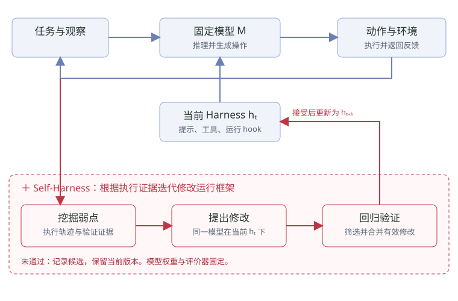

<strong>问题：</strong>不同模型存在不同的执行弱点，人工逐个调整运行框架成本很高；<strong>方法：</strong>Self-Harness 让同一个模型根据执行证据提出 harness 修改，验证后用于后续迭代。

<!-- more -->

## 1．它改的是什么？

Harness 是模型周围的运行框架，负责组织上下文、执行工具、控制任务进程，以及检查结果。Self-Harness 将这层运行框架作为修改对象，让同一个模型在当前 harness 下提出候选修改，再使用通过验证的新版本。

*根据论文 §3 整理的结构示意，非论文原图。红色标记从执行证据到框架更新的支路。*

自修改的边界

<strong>模型权重保持不变，改进循环与验收规则仍由作者预先设计。</strong>它研究的是受约束的 harness 自修改，不是系统可以任意重写自身所有规则。

## 2．三个阶段怎样连起来？

### Weakness Mining：从失败中找到可修改的机制

首先运行当前 Agent，收集执行轨迹和验证结果，再归纳重复出现的失败模式。

关键不只是把相同错误放在一起，而是区分：**最终失败是什么，以及什么行为导致了失败。**

下面是一个教学例子，并非论文实验轨迹：

| 最终结果 | 可能的原因 | 对应修改方向 |
| --- | --- | --- |
| 没有输出文件 | 一直探索，没有开始实现 | 调整执行控制 |
| 没有输出文件 | 写到了错误目录 | 改善路径与状态管理 |

两个任务都缺少文件，却未必需要同一种修复。

### Harness Proposal：把弱点转成局部修改

系统将失败证据交给同一个模型，让它在当前 harness 下提出候选修改。

每个候选应对应具体机制，并说明修改位置、预期效果和回归风险。这样，修改就形成了一个可以检验的假设：改变这个运行机制，应该能减少这一类失败。

### Proposal Validation：运行之后再决定是否保留

候选修改不会直接进入正式版本，而是先接受回归测试。

论文要求：**held-in 与 held-out 两个划分都不退步，且至少一个有所改善，才接受候选。**通过的兼容修改合并为下一版 harness，再进入下一轮。

<strong>执行并发现弱点 → 提出修改 → 验证并更新 → 使用新版本继续</strong>

新版本既用于后续任务，也用于同一模型下一轮提出修改。因此，迭代发生在模型的运行机制上，而非模型权重上。

## 3．除了循环顺序，还有什么值得关注？

“发现问题—修改—验证”本身是常见的工程流程。我认为，这篇更值得关注的是三个具体设计。

**首先，同一个模型参与改进自己的运行框架。**它不依赖更强的外部 Agent，而是研究当前模型能否通过调整工作机制，缓解自身弱点。

**其次，诊断目标是可干预的失败机制。**从“任务失败”进一步定位到“哪种运行行为需要改变”，决定了修改是否有依据。

**最后，修改具有明确范围和验证条件。**系统需要检查预期改善是否出现，以及原本能完成的任务是否因此退步。

这些设计共同构成了一种可追踪的改进过程。不过，轨迹中的解释仍然只是故障假设；要证明修改有效，必须回到实际执行。

<aside class="paper-question">
我的疑问：验证集参与了持续筛选，还能代表最终泛化吗？

论文中的 held-out 轨迹不向提案模型开放，但对应表现参与了候选筛选。因此，读结果时还需要区分：对回归验证集的改善，与对完全独立新任务的泛化。这是阅读时的评价疑问，不是作者已经证明的结论。
</aside>

## 4．三个测评基准：框架改进能帮助哪些任务？

### Terminal-Bench 2.0：在终端里完成真实工作

它提供容器化的终端环境，要求 Agent 执行多步骤技术任务，并通过测试检查结果。

简化教学示例

给定一个无法正常运行的项目，让 Agent 检查依赖、修改配置并成功运行程序。只解释原因不够，需要真正改变环境、完成任务。

这类任务能检验工具调用、环境状态管理，以及重复失败后的恢复能力。

### SWE-bench Verified：修复真实代码仓库的问题

它以真实 GitHub issue 为任务，要求 Agent 阅读仓库、定位错误并提交代码补丁，通过测试验证修复结果。

简化教学示例

某个函数处理特殊输入时抛出异常。Agent 需要找到相关实现、修改代码，并检查修复后是否破坏原有行为。

这类任务能检验代码探索、补丁编辑和完成前验证等机制。

### AppWorld：通过代码操作多个应用

它提供模拟的日常应用与 API。Agent 需要编写、执行代码，根据反馈完成跨应用任务；评测检查目标状态，也检查是否造成无关修改。

简化教学示例

读取购物清单，在购物应用中找到对应商品并加入购物车。Agent 需要查询信息、匹配商品，再调用接口更新状态。

注意，**这里主要通过代码与 API 操作应用，不是看着手机界面点击按钮。**

| 基准 | 主要操作对象 | 核心检验 |
| --- | --- | --- |
| Terminal-Bench 2.0 | 终端与运行环境 | 能否把技术任务实际做完 |
| SWE-bench Verified | 代码仓库 | 能否生成有效修复补丁 |
| AppWorld | 应用 API 与数据状态 | 能否正确完成多步骤应用操作 |

Self-Harness 用这三类任务检查运行框架修改的效果。**在每类任务上有效，与同一套修改能跨基准迁移，是两个不同的结论，读实验时需要区分。**

这篇给我的启发是：自进化的难点不仅在于生成补丁，还在于建立可靠的联系——**为什么要改这里，预计改变什么行为，以及结果是否真的支持这个判断。**

[Self-Harness 原文（v3，§3–4）](https://arxiv.org/html/2606.09498v3) · [Terminal-Bench](https://arxiv.org/abs/2601.11868) · [SWE-bench Verified](https://openai.com/index/introducing-swe-bench-verified/) · [AppWorld](https://arxiv.org/abs/2407.18901)
