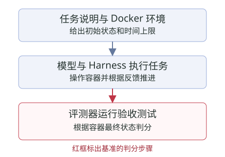

**arXiv 首发** [2026-01-17](https://arxiv.org/abs/2601.11868) · **发表场合** [ICLR 2026 主会（Poster）](https://openreview.net/pdf?id=a7Qa4CcHak) · **阅读版本** [arXiv v1（2026-01-17）](https://arxiv.org/html/2601.11868v1)

为了测量 Agent 在终端里实际完成多步骤任务的能力，Terminal-Bench 2.0 为 89 道题提供可复现的运行环境，并用测试验收容器的最终状态。

<!-- more -->

## 一道题怎样判分

每道题包含任务说明、Docker 环境、时限、测试和人写的参考解法。Agent 拿到说明后在容器里操作，评测器根据最终产物给出结果。参考解法供维护者确认任务可解，也让测试有一个已知能通过的对照。[论文 §2.1–2.3](https://arxiv.org/html/2601.11868v1#S2)

*根据论文 §2 整理的评测流程示意。*

论文里有一道题要求把 COBOL 程序重写成 Python。两个 Agent 可以用不同的方法理解原程序和实现新程序，测试比较的是给定输入下的输出是否一致。**任务说明写清楚了什么，测试覆盖了什么，决定了这个通过率能说明什么。** 作者从 229 道社区提交的任务中筛出 89 道，审查任务说明与测试是否一致、参考解法能否通过，以及是否存在误判。[论文 §2.2–2.4](https://arxiv.org/html/2601.11868v1#S2.SS2)

## 第 3 章：怎么比较模型和 harness

**Terminus 2 给不同模型提供共同的操作接口。** 它在 Docker 容器的 tmux 终端里执行模型发出的按键操作，再把终端输出交回模型。读取文件、修改代码和运行测试都走这个接口。上下文接近模型上限时，Terminus 2 会调用模型摘要历史。固定这套框架换模型，可以观察不同模型如何利用相同类型的终端反馈推进任务。[论文 §3.1、附录 F](https://arxiv.org/html/2601.11868v1#S3.SS1)

论文共测了六种 Agent：Terminus 2、Codex CLI、Claude Code、Gemini CLI、OpenHands 和 Mini-SWE-Agent。前三个品牌 CLI 分别接各自厂商的模型，其他组合按兼容性选择。可调推理强度的模型使用供应商默认设置。论文对每个受支持的组合至少重复跑五轮，共记录 **32,155 次尝试**。一次尝试是一套模型与 Agent 组合做一道题的一次运行。[论文 §3.2–3.3](https://arxiv.org/html/2601.11868v1#S3.SS2)

**Terminal-Bench 提供题目和验收测试，Terminus 2 负责做题，Harbor 负责调度评测。** 作者用 Harbor 在 Daytona 上并行运行 32 至 100 个容器。Harbor 也可以调度 Codex CLI 等其他 Agent。[论文 §3.4](https://arxiv.org/html/2601.11868v1#S3.SS4)

## 第 4 章：成功率、成本和失败原因

### 模型与 harness 都会影响分数

论文当时测得的最高分是 **GPT-5.2 + Codex CLI 的 62.9%**。Claude Opus 4.5 和 Gemini 3 Pro 搭配 Terminus 2 分别达到 **57.8%** 和 **56.9%**。附录表 2 也可以按固定模型或固定框架来读。[论文 §4、附录 A 表 2](https://arxiv.org/html/2601.11868v1#A1)

| 想看什么 | 固定项 | 实际对照 | 差值 |
| --- | --- | --- | --- |
| 换模型的影响 | Codex CLI | GPT-5-Nano **11.5%** → GPT-5.2 **62.9%** | 51.4 个百分点 |
| 换 harness 的影响 | GPT-5.2 | Terminus 2 **54.0%** → Codex CLI **62.9%** | 8.9 个百分点 |
| 换 harness 的影响 | Gemini 2.5 Pro | OpenHands **15.7%** → Terminus 2 **32.6%** | 16.9 个百分点 |

作者认为，在这组实验中换模型通常影响更大。表里的两组框架对照仍相差近 9 个点和近 17 个点。因为两组对照换的是整套框架，要确定收益来自工具接口、上下文管理还是其他组件，还要逐项比较。[论文 §4](https://arxiv.org/html/2601.11868v1#S4)

### 成本和模型进步如何衡量

大多数尝试在 **20 分钟内**结束，极端个例接近 **两小时**。作者固定 Terminus 2，比较各模型的平均交互轮数、输出 token 数和成功率，两项开销与成功率的相关性都很弱。这组数据描述的是模型之间的差异。要测增加预算有没有用，可以固定同一模型和框架，再改变预算。[论文 §4.1、附录 G](https://arxiv.org/html/2601.11868v1#S4.SS1)

作者还比较了模型发布日期和评测成绩。从 Gemini 2.5 Pro 发布到 GPT-5.2 发布约八个月，实测最佳成绩接近翻倍。这里每个模型都取它搭配被测框架的最高分，因此曲线描述的是当时可用的模型与 Agent 组合的进步。[论文 §4.2](https://arxiv.org/html/2601.11868v1#S4.SS2)

### 人评难度与实测难度

实测难度依据多种模型用 Terminus 2 做同一道题的通过率划分。低于约三分之一归为困难，达到约三分之二归为容易，中间归为中等。出题人标为**困难**的题里，**93.3%** 在实测中也属于困难。出题人标为**中等**的题里，也有 **54.5%** 在实测中属于困难。因此，同一句「困难题提高了几个点」，要先看用的是哪种难度定义。[论文 §4.3](https://arxiv.org/html/2601.11868v1#S4.SS3)

### 整条轨迹和单条命令各能说明什么

**整条轨迹分析**固定 Terminus 2，从失败尝试中抽样，用人标数据校准模型裁判，再判断问题出在哪里。执行类问题包括违反明确要求。连贯性问题包括忘记之前已确认的环境状态。验证类问题包括只检查文件是否存在就宣布完成。在被分析的失败样本里，GPT-5.2 和 Claude Opus 4.5 的执行类错误占主导，Qwen Coder 的三类错误分布更均衡。[论文 §4.4、附录 C](https://arxiv.org/html/2601.11868v1#S4.SS4)

**单条命令分析**看终端命令及其输出。不同模型的命令错误率约为 **9.2%–26.7%**。作者又抽取 **3,800 条失败命令**分类，其中 **24.1%** 涉及可执行程序未安装或不在 `PATH`。前一组比例以各模型被分析的命令为分母，后一项以抽样的失败命令为分母。命令报错后还有机会恢复，整题是否完成由最终测试判定。[论文 §4.5](https://arxiv.org/html/2601.11868v1#S4.SS5)

## 2.0 到今天还能怎么用

截至 **2026-11-24**，官方榜单最高完成率在 2.0 上为 **84.7%**，在 2.1 上为 **87.4%**，在 4.1 上为 **71.2%**。这是不同版本上各自最高的模型与 Agent 组合成绩。要复现旧论文，用原版题集并对齐运行设置。要区分当前的强 Agent，可以用更新的 4.1。研究 harness 自进化时，还可以把从未参与筛选的任务留作独立验证，看看收益能否迁移。[2.0 榜单](https://www.tbench.ai/?version=2.0) · [2.1 榜单](https://www.tbench.ai/?version=2.1) · [4.1 榜单](https://www.tbench.ai/?version=4.1)

论文也指出，容器和依赖版本固定之后，网络资源、硬件与运行环境仍可能变动。公开题集还面临训练数据污染的可能。跨论文比较时，题集版本、模型、时限、重试次数和运行环境都值得一起核对。[论文 §5](https://arxiv.org/html/2601.11868v1#S5)

<aside class="paper-question">

如果评分器改了，演化还会留下同样的修改吗？

Terminal-Bench 2.1 修订了 2.0 的 89 道题中的 28 道，部分此前无人解出的题在修订后有了通过记录。当通过率决定哪些 harness 修改会被留下时，评分器的偏差也会影响演化选择。一个直接的检查是，用修订后的评分器重新评估同一批候选，看看被选中的版本是否变化。

</aside>

[Terminal-Bench 2.1 官方更新说明](https://www.tbench.ai/news/terminal-bench-2-1)
