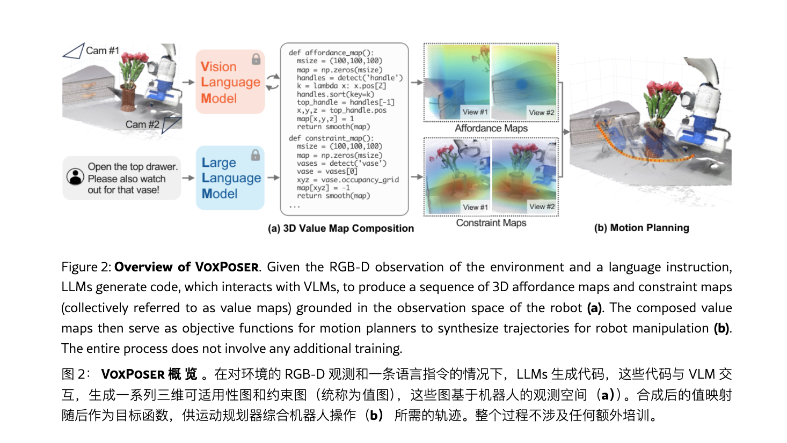

[**VoxPoser（2023）**](https://arxiv.org/abs/2307.05973) 解决的不是「让 LLM 直接控制机械臂」，而是**让 LLM 告诉规划器，在眼前这个场景里，什么算一条好轨迹**。比如「打开上层抽屉，别碰花瓶」：夹爪要靠近哪个把手、往哪里拉、哪里要绕开？这些要求可以变成三维地图，再交给运动规划器。

<!-- more -->

## 图 2：LLM 写的代码，执行后真的能得到地图吗？

*图 2，来自 [原论文 §3](https://arxiv.org/html/2307.05973v2#S3)。中间的代码是构图配方；右边的橙线才是规划结果。*

可以。**前提是已经有感知和网格工具**。图中 LLM 写的代码先建一张三维网格，然后分别调用已有接口找把手和花瓶。可供性图里，代码把找到的把手按高度排序，在最高的把手处标正分；约束图里，代码在花瓶占据的格子标负分，再把影响扩展到附近。两张图的不同视角只是为了展示同一类三维结果。

这里有三个分工：

| 模块 | 实际负责什么 |
| --- | --- |
| **LLM** | 从指令推断要查什么、怎么选目标、哪里值得靠近或避开，并生成调用接口的代码。 |
| **感知接口与代码执行器** | 根据 RGB‑D 观测定位物体或部件，把当前场景的实际坐标写进地图。 |
| **规划器** | 用地图和机器人的运动约束，算出末端执行器经过的位置与朝向。 |

单看这个固定例子，人也能写出两个构图函数。LLM 的价值是**换一条指令时可以现场换规则**：「开下层抽屉，避开杯子」需要选更低的把手，还要换一个避让对象。如果只是花瓶挪了位置，规则可以不变，变化的是感知提供的坐标。两种变化分别由不同组件处理。

论文的实现不只有图里的两种地图。可供性和避让主要用于搜索末端位置；旋转、速度和夹爪开合地图再为沿途位置指定相应行为。所谓「可组合」，是同一条轨迹可以同时考虑靠近目标和避开障碍等要求，不必把它们写成互不相干的动作指令。（§3.2–3.3）

## 地图怎么变成轨迹？

读到任务代价和零阶优化时，可以把它理解成：**规划器能给候选动作或路线打分，就可以比较哪条更好，不需要由 LLM 再评一次，也不必求目标函数的梯度。** 原文用随机采样解释通用优化框架；具体实现要区分：普通末端位置路径用贪心搜索，平面推物体的实验则随机采样接触点、方向和距离等动作参数。

**MPC（模型预测控制）说的是执行节奏**：先往前规划一段，执行第一步，然后用新观测重新规划。图里的橙线不是一次算好就一直照着走。如果花瓶被挪动，规划器可以根据更新的观测改道。在普通末端规划里，论文多数时候把场景视为静态来预测，靠反复重规划应对变化；这不等于它有一个准确预测所有物体运动的物理模型。（§3.3、§4 实现细节）

这和 π₀ 都有「往前看一段，再根据观察更新」的节奏，但**π₀ 用学到的策略生成动作块；VoxPoser 显式构造评分，再用规划器搜索轨迹**。相比 SayCan 的技能选取，VoxPoser 把语言的影响推进到了轨迹层，但仍依赖感知、控制器和任务假设；部分推物体的设置也用了预定义推运动作。（§4 实现细节）

## 实验：零样本规划能做到哪一步？

- **真机操作与扰动（表 1）**：在 5 项代表性任务上，每项每种条件试 10 次。VoxPoser 在静态和扰动条件下分别成功 **88% 和 70%**，论文中的 LLM＋动作原语基线分别为 **24% 和 0%**。这是整套系统的对比，不是对重规划单一组件的因果估计。
- **未见指令与属性（表 2）**：仿真包括 13 个可随机化任务。未见指令与未见属性同时出现时，物体操作和空间组合两类的成功率分别为 **65.0% 和 76.7%**。这里的「未见」相对于提示示例或基线训练集，测试仍由任务模板和属性设置界定。
- **接触动力学（表 3）**：门、窗和冰箱的仿真实验里，零样本路线通常有意义，却常常打不开目标。作者把这些路线当成**探索起点**，在附近试动作，用结果训练动力学模型。以开窗为例，成功率从零样本的 **3.3%** 升到有轨迹先验并在线学习后的 **80.0%**；这不是零样本真机开窗的成绩。

最后一组实验说明：**地图定义想要什么，动力学模型预测动手后会发生什么。** 知道「该拉把手」并不等于知道门的转轴、接触和阻力会怎样影响结果。论文也指出，真机失败常来自感知，特别是物体部件的检测；主要规划的是末端轨迹，不能把它当作对整条机械臂的完整避碰保证。（§4.3–5）

这篇最值得带走的是**语言如何变成可以优化的任务目标**。运动规划器负责找路，LLM 把「什么算做对」写成能随场景变化的规则。论文还展示了同一份知识能用来引导在线探索，但没有因此消除真实接触操作对动力学和感知的依赖。

[原论文（arXiv v2）](https://arxiv.org/html/2307.05973v2) · [项目演示](https://voxposer.github.io/)
